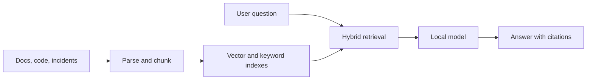

# Engineering Intelligence Hub

A local knowledge assistant for engineering teams. Bring documentation, source code, and incident reports together, then ask questions in natural language and get answers with source citations.

Inference and embeddings run locally through Ollama, with no hosted inference API keys required. Initial setup downloads dependencies and models; Git ingestion requires access to the selected repository.

## Features

- **Multiple knowledge sources** — Ingest Markdown documentation, code repositories, and JSON/CSV incident reports.
- **Code-aware processing** — Parse supported programming languages with tree-sitter and split content into searchable chunks.
- **Hybrid search** — Combine semantic vector search and BM25 keyword search using Reciprocal Rank Fusion.
- **Cited answers** — Generate responses grounded in retrieved content, with references to source files.
- **Conversational interface** — Chat through Streamlit, stream responses, and ask follow-up questions.
- **Source management** — Add sources, monitor ingestion, and filter searches.
- **Evaluation** — Compare retrieval strategies and measure answer faithfulness and latency.

## How It Works



Streamlit provides the interface, FastAPI serves requests, and Celery handles queued ingestion. ChromaDB stores vectors, BM25 supports keyword search, and SQLite stores document content and metadata.

## Tech Stack

| Area | Technology |
|---|---|
| Interface | Streamlit |
| API | FastAPI, Uvicorn |
| Models and embeddings | Ollama |
| Search | ChromaDB, BM25 |
| Code parsing | tree-sitter |
| Metadata | SQLite, SQLAlchemy |
| Background jobs | Celery, Redis |
| Tooling | uv, pytest, Ruff, mypy, Docker Compose |

## Quick Start

Install Git, Docker with Compose, and Make. Then:

```bash
git clone https://github.com/gvs0923/Intelligence-Hub.git
cd Intelligence-Hub
[ -f .env ] || cp .env.example .env
make docker-up
```

Once startup and model downloads finish, load the sample data when no ingestion jobs are active:

```bash
make seed
```

Open the interface at **http://localhost:8501**. Interactive API documentation is available at **http://localhost:8000/docs**.

Add a source or use the sample corpus, then try a question such as:

> Why can a Kubernetes pod be evicted?

Designed for local, trusted use. See the deployment guide before using it in another environment.

## Run Locally Without Docker

Requires Python 3.11+, uv 0.12.23+, and Ollama. With Ollama running:

```bash
make setup
ollama pull nomic-embed-text
ollama pull llama3.2:3b
make dev
```

Run `make ui` in another terminal. Chat requires indexed data; queued ingestion also requires Redis and `make worker`. See the deployment guide for native data seeding and configuration.

## Development

| Command | Purpose |
|---|---|
| `make check` | Run lint, type checks, and tests with coverage |
| `make test` | Run tests with coverage |
| `make eval` | Evaluate retrieval against seeded local indexes |
| `make docker-down` | Stop the Docker stack without deleting stored data |

## Documentation

- [Architecture](docs/architecture.md)
- [Setup and deployment](docs/deployment.md)
- [Testing](docs/TESTING.md)
- [Evaluation methodology](docs/evaluation.md)

## Project Structure

```
src/
├── api/           # FastAPI app, routes, middleware, request/response models
├── config.py      # Centralised configuration (Pydantic Settings)
├── db/            # SQLAlchemy ORM models & session management
├── ingestion/     # Data source ingesters & chunking strategies
├── indexing/      # Embedding providers
├── retrieval/     # Dense, sparse, and hybrid retrievers
├── generation/    # LLM prompt & generation layer
├── ui/            # Streamlit front-end
└── logging_config.py
```
