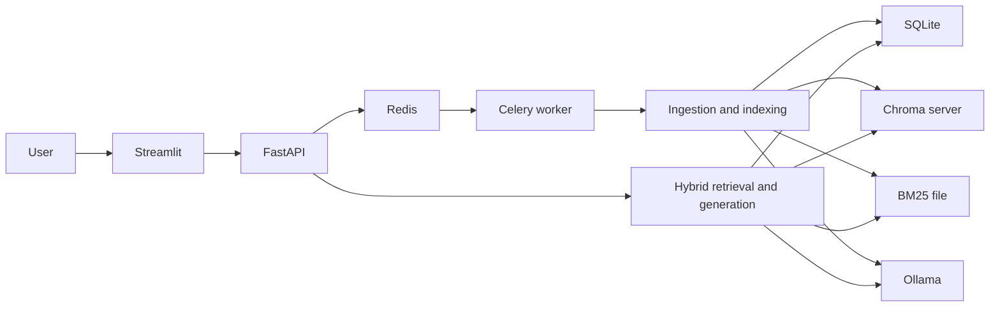

# Engineering Intelligence Hub

A fully local RAG (Retrieval-Augmented Generation) system that lets engineering teams ingest their codebases, documentation, and incident reports — then query everything with natural language.

No hosted inference API keys required. LLM inference and embeddings run on Ollama; initial dependency/model downloads and optional Git ingestion require network access.

## What It Does

1. **Ingest** — Point it at a Git repo, a folder of Markdown docs, or incident logs. It reads, parses, and chunks the content intelligently (AST-aware chunking for code, semantic splitting for prose).
2. **Index** — Chunks are embedded into vectors (Ollama / sentence-transformers) and stored in ChromaDB, with a parallel BM25 sparse index for keyword matching.
3. **Retrieve** — Hybrid retrieval combines dense (vector) and sparse (BM25) results using Reciprocal Rank Fusion for better recall than either alone.
4. **Generate** — The top-k relevant chunks are fed as context to a local LLM to produce grounded, source-cited answers.
5. **Query** — Ask questions through a REST API or a Streamlit UI.

## Tech Stack

| Layer | Technology |
|---|---|
| API | FastAPI + Uvicorn |
| LLM & Embeddings | Ollama (llama3.2, nomic-embed-text) |
| Vector Store | ChromaDB |
| Sparse Index | BM25 (rank-bm25) |
| Code Parsing | tree-sitter |
| Database | SQLite + SQLAlchemy 2.0 |
| Task Queue | Celery + Redis |
| UI | Streamlit |
| Logging | structlog |
| Package Manager | uv |

## Quick Start

Requires Git, Docker with Compose v2 or newer, and enough disk/RAM for two Ollama models plus the Python ML dependencies. For native development, install Python 3.11+ and uv 0.12.23 or newer.

```bash
git clone https://github.com/gvs0923/Intelligence-Hub.git
cd Intelligence-Hub
[ -f .env ] || cp .env.example .env
make docker-up
```

This starts FastAPI, Streamlit, a single Celery worker, Ollama, ChromaDB, and Redis. A one-shot model service downloads `nomic-embed-text` and `llama3.2:3b` before the API starts. Initial startup requires internet access and can take substantially longer than subsequent starts.

Once the API is healthy, load the demo corpus:

```bash
make seed
```

Seeding stops the worker to avoid concurrent index writers and starts it again afterward, including on failure. Run it when ingestion is idle. It loads Markdown, incidents, Java code, and the configured public Git repository. Existing Docker volumes are retained; local `data/` indexes are not automatically migrated into the new Chroma server.

Open Streamlit at `http://localhost:8501` and interactive API docs at `http://localhost:8000/docs`.

| Endpoint | Purpose |
|---|---|
| `GET /api/live` | HTTP process liveness; no dependency probes |
| `GET /api/health` | Diagnostic component status; inspect the JSON, not just HTTP 200 |
| `GET /api/stats` | Source, document, chunk, and index counts |
| `POST /api/ingest` | Register a source and queue ingestion |
| `GET /api/ingest/{job_id}` | Poll ingestion progress |
| `POST /api/query` | Ask for a cited answer |
| `POST /api/query/stream` | Stream answer events using SSE |
| `GET /metrics` | Prometheus metrics |
| `GET /docs` | Interactive Swagger API documentation |
| `GET /openapi.json` | Machine-readable API schema |

An empty installation reports degraded BM25 health until data is indexed. Liveness alone does not prove retrieval readiness.

## Local Development

```bash
make setup
make dev
```

Run `make ui` in another terminal to inspect the UI without Docker. The UI and evaluation implementations are present; their prerequisites are runtime services and compatible indexes, not missing code:

| What you want to test | Prerequisites |
|---|---|
| UI rendering / API liveness | `make dev` + `make ui`; no model needed just to open the UI |
| Chat and citations | API + UI, Ollama with both models, seeded indexes |
| Queued ingestion from the UI | Above, plus Redis and `make worker` in another terminal |
| Evaluation | Ollama + seeded local indexes; API/UI/Redis/worker are not required |

Pull the native models while Ollama is running:

```bash
ollama pull nomic-embed-text
ollama pull llama3.2:3b
```

For native synchronous seeding, run when no queued ingestion is active:

```bash
uv run --frozen python -m scripts.seed_demo_data \
  --docs corpus/docs --incidents corpus/incidents.json \
  --repo https://github.com/nolar/kopf --code corpus/java
```

Use the same storage configuration for the API, seed script, worker, and evaluation. `make seed` is specifically the Docker seeding path, not native seeding. Native development defaults to embedded Chroma; Compose sets `CHROMA_HOST=chroma` to use the server. Native Ollama is usually faster on Apple Silicon because Linux containers do not get equivalent Metal acceleration. Stop native API/UI processes before starting Compose on the same ports.

```bash
make lint
make typecheck
make test
make check
make eval EVAL_ARGS="--limit 5"
```

Tests isolate SQLite, Chroma, and BM25 storage in a temporary directory. Coverage enforces 80% line-and-branch coverage for the backend; Streamlit rendering is excluded, while its HTTP client still has functional tests. `make eval` evaluates local indexes and requires a seeded corpus plus Ollama. It does not use Docker's named volumes.

GitHub Actions runs lint, mypy, pytest/coverage, Compose validation, and an application image build. It does not publish or deploy the image.

## Architecture



## Deployment and limitations

This is a trusted-local, single-host deployment, not a public multi-tenant service. Only API/UI ports bind to localhost. Keep one ingestion writer; SQLite and BM25 storage are not designed for horizontally scaled workers. `make docker-down` stops services without deleting volumes. Never delete volumes as a routine troubleshooting step.

- [Architecture decisions](docs/architecture.md)
- [Deployment and verification](docs/deployment.md)
- [Evaluation methodology](docs/evaluation.md)
- [Phase 9 implementation notes and lessons](docs/phase-9-production-hardening.md)
- [Testing manual, including Phase 9](docs/TESTING.md)

During Phase 9 implementation, local `make check` passed with 85 tests and 86.80% combined backend statement/branch coverage. These are test results, not retrieval or latency benchmarks. Compose configuration validated, but the image build was blocked by certificate trust inside the build container; full-stack Docker and real-model benchmark results remain unverified. See the phase notes for the exact verification boundary.

Image tags/digests can be overridden through `OLLAMA_IMAGE`, `CHROMA_IMAGE`, and `REDIS_IMAGE`. Pin tested digests for a release and validate model/image upgrades before reusing existing indexes.

## Project Structure

```
src/
├── api/           # FastAPI app, routes, middleware, request/response models
├── config.py      # Centralised configuration (Pydantic Settings)
├── db/            # SQLAlchemy ORM models & session management
├── ingestion/     # Data source ingesters & chunking strategies
├── indexing/      # Embedding providers
├── retrieval/     # Dense, sparse, and hybrid retrievers
├── generation/    # LLM prompt & generation layer
├── ui/            # Streamlit front-end
└── logging_config.py
```

