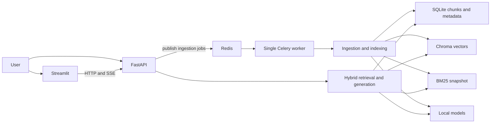

# Architecture decisions

## Deployment topology

This is the implemented Compose topology, not a proposed replacement for the RAG pipeline. The vector-store wrapper already supports both HTTP and persistent clients; Phase 9 wires Compose to the HTTP branch. In native development, the same Chroma node is embedded by default rather than a separate service. Streamlit's real entrypoint is `src/ui/app.py`; evaluation's entrypoint is `evaluation.benchmarks.run_benchmark`. Neither implementation is missing from this checkout.

## One host, separate processes

FastAPI handles HTTP requests, Streamlit is an HTTP client, and one Celery worker handles queued ingestion through Redis. The worker uses the solo pool and concurrency one because SQLite and the BM25 snapshot have a single-writer operating model. Do not scale worker replicas or seed concurrently with ingestion.

The API initializes SQLite tables before the worker starts. `create_all` bootstraps an empty database; it is not a migration system for future schema changes.

## Storage responsibilities

- SQLite is the source of truth for sources, jobs, document text/chunks, and query analytics.
- Chroma stores vectors and retrieval metadata, keyed by vector IDs associated with SQLite chunks.
- BM25 is persisted as a local pickle and rebuilt by ingestion. Never load a pickle supplied by an untrusted party.
- Redis persists queue state using append-only persistence.

Native development uses embedded Chroma by default. Compose configures `CHROMA_HOST=chroma`, using the already-supported HTTP client so API and worker do not open the same embedded vector database. An explicit `VectorStore(persist_dir)` still selects embedded storage for isolated tests.

SQLite/BM25 share `app_data`; Chroma, Redis, and Ollama have separate named volumes. Switching from a host-local index to a server does not migrate data. Re-ingest into a fresh consistent deployment rather than copying an arbitrary subset of these stores.

Cross-store ingestion is not a distributed transaction. A crash between vector changes and SQLite commit can leave drift. Compare SQLite chunk counts and Chroma vector counts and inspect job errors. Equal counts are only a sanity check, not proof of equal content.

## Retrieval and generation

Dense retrieval and BM25 retrieval are combined with reciprocal-rank fusion. Query rewriting and reranking use the local model. Confidence gating can refuse an answer when context is insufficient. Generation uses retrieved context and returns citations. The evaluator measures retrieval separately from generation to avoid conflating retrieval failures with model failures.

## Startup and health

Redis and Chroma must be healthy. Ollama must be running and the one-shot model-pull service must complete before the API starts. The worker and UI wait for API liveness.

`/api/live` checks only HTTP process availability. `/api/health` probes dependencies and the persisted BM25 index, returning `ok` or `degraded` in a JSON body. It is diagnostic, not an HTTP readiness gate: it returns 200 even for degradation. An empty corpus must not create a startup dependency cycle.

## Security and release boundary

API/UI ports bind to loopback. Internal Redis, Ollama, and Chroma ports are not published. The application image runs as non-root; corpus mounts are read-only. This does not supply authentication or authorization. Do not expose ingestion (which accepts filesystem paths and Git locations) to untrusted users.

Release dependencies use `uv.lock` with frozen installs. uv is version-pinned; infrastructure images have explicit tags or a digest and allow overrides. Base-image and action major-version tags are still mutable: audit and pin verified digests/SHAs for release promotion. CI builds but does not deploy. Model tags can also change independently of Python dependencies.
